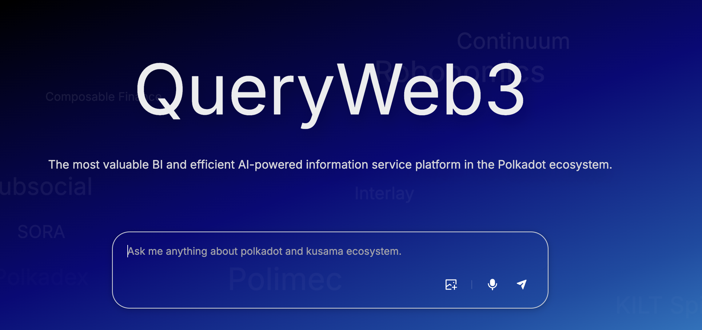

# QueryWeb3 — 为 Polkadot 生态做投资决策的数据基础设施

把 Polkadot / Kusama 生态分散在各条链与各个 DeFi 协议里的数据，统一加工成 BI 宽表，
再用 AI 把用户的问题落到具体查询上 —— 查收益率、查交易趋势、查项目动态，一次提问拿到结论。

> Data infrastructure for investment decisions in the Polkadot ecosystem: BI-grade tables
> plus intent-based query.

## 目录

| 文件 / 目录 | 内容 |
| :---- | :---- |
| [PRD.md](PRD.md) | 产品需求文档：三个用例的角色、数据源、数据流与验收口径 |
| [MILESTONE-1.md](MILESTONE-1.md) | 里程碑 1 验收清单：交付物 → 证据 → 核验结论 |
| [UI/](UI/) | 三个用例的产品界面设计稿 |
| [business flow/](business%20flow/) | 用例一与用例二的业务流程图 |

## 用例一：AI 信息服务

聚合链上基础数据与生态活动信息（文档、代码活动、融资、社区与媒体内容），用 AI 抽取用户意图，
把检索动作压缩成一次提问。

## 用例二：Yield Query

按任意日期查询各链资产的收益率快照（TVL、24 小时成交额、交易笔数），并给出生态收益率
Top 10 与 TVL Top 10 榜单。

## 用例三：Vol & Txns Query

按日 / 周 / 月 / 季 / 半年 / 年查询交易量与交易笔数，带同比与环比，并给出 Top 10 链榜单
与趋势图。

## 里程碑

| 里程碑 | 范围 | 状态 |
| :---- | :---- | :---- |
| M1 | DeFi 索引器、事实表与维度表、数据后端 | 已交付，验收见 [MILESTONE-1.md](MILESTONE-1.md) |
| M2 | Staking 索引器、官网与查询服务、BI 可视化 | 规划中 |
| M3 | 大数据后端、基于意图的 BI 查询 | 规划中 |

## 许可

交付代码采用 Apache 2.0。
